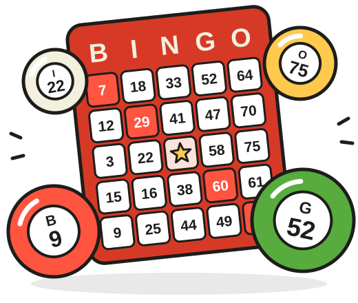

# Bingo

## Indice
- [1 Introdução](#intro)
- [2 Regras do jogo](#regras)
   - [2.1 Apresentação](#apresentacao)
   - [2.2 Definições](#defs)
- [3 Conclusao](#conclusao)

## Introdução 
O Bingo foi criado com o propósito recreativo para uso entre amigos durante uma festa junina online. O jogo consiste na produção de cartelas com 24 números de 1 a 75 e no sorteio posterior destes. 

## Regras do Jogo
### Apresentação
Antes de cada partida, o jogador escolhe quantas cartelas deseja usar (no máximo 4) simultaneamente. Quando a partida começa, os números são sorteados, um por um, aleatoriamente, e o jogador deve verificar se eles estão em sua cartela.

**Caso um número sorteado esteja na cartela do jogador, ele deverá marcá-lo.**

É importante saber qual o padrão e a regra da partida, isto é, quais padrões devem ser completados para que o jogador possa bingar. Geralmente, pode ser uma linha horizontal, uma linha vertical, uma diagonal, ou os 4 cantos da cartela. Mesmo assim, recomenda-se verificar o padrão antes de começar a jogar.

De acordo com a regra, o jogador deverá cantar Bingo assim que completar um dos padrões. Quem canta diz o código da sua cartela, e o painel da TV confere se o Bingo vale. Um Bingo incorreto é recusado e o jogo continua.

O primeiro Bingo válido encerra a partida.

Os jogadores ficam na mesma sala, cada um com as cartelas no próprio celular. Cada número é sorteado no painel da TV, ao clicar em "Sortear" ou automaticamente, de forma aleatória, de 1 a 75 e sem repetição.

### Definições: 
- **Marcar número** - É o ato de assinalar na cartela que um número foi sorteado. Serve para o jogador perceber quando completou um padrão; o painel confere o Bingo pelos números sorteados.
- **Cartela** - Cada cartela tem 24 números aleatórios de 1 a 75, dispostos em uma grade de 5 linhas e 5 colunas. O centro é livre e conta como marcado.
- **Padrões** - O padrão é a regra que define quais marcações serão consideradas válidas. É importante saber o padrão da fase antes de começar a jogar.
- **Cantar/Fazer Bingo** - É o ato de declarar vitória. Só é possível cantar se um dos padrões da fase estiver completo.

## O desafio do desenvolvimento
A proposta da criação do projeto se baseia na premissa da criação de um jogo prático e de rápido desenvolvimento para uma reunião entre amigos que estava atrasada. A primeira versão do jogo foi criada em apenas 1h e 30min. Os recursos utilizados se limitam em HTML, JavaScript e CSS puros.

> "*Ser simples é o que te faz grande*"
